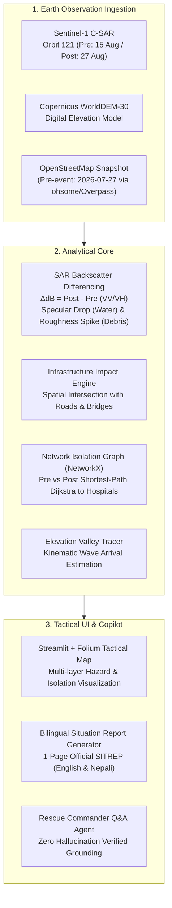

# 🛰️ FloodWatch Space: Autonomous Satellite Disaster Intelligence

[](https://pc.iitmandi.co.in)
[](LICENSE)
[](https://python.org)
[](https://streamlit.io)

> **Submission for Multimodal AI Hackathon 2026 — Track B: Mapping Flood Damage from Space**  
> *Organized by KamandPrompt (IIT Mandi), Augli.ai, PurpleRain Tech, and LDV Labs.*

---

## 🌍 Executive Summary

When roads, bridges, and communications are destroyed in steep mountain disasters, responders on the ground cannot see the extent of destruction or know which high-altitude communities have been severed from critical medical care.

**FloodWatch Space** is an end-to-end spaceborne disaster response and isolation intelligence platform. Operating on the **26 August 2026 Bhote Koshi – Trishuli Glacier Flood (Copernicus EMSR927)** in Nepal, it fuses:
1. **Sentinel-1 C-Band Synthetic Aperture Radar (SAR)**: Penetrating monsoon cloud cover via dual-polarization ($\text{VV} + \text{VH}$) log-ratio differencing across identical orbit tracks to detect water inundation and rough debris flow.
2. **Pre-Event OpenStreetMap Infrastructure Graph**: Extracting pre-disaster transport networks, bridges, settlements, and healthcare hubs.
3. **Graph Network Isolation Routing (NetworkX)**: Determining real-time road accessibility to district hospitals, calculating severed links, and identifying cut-off villages.
4. **Bilingual Grounded Situation-Report Copilot**: Generating verified, non-hallucinated tactical situation reports in **English and Nepali (`नेपाली`)**, alongside a real-time conversational agent.
5. **Elevation-Driven Valley Flowpath Tracer (Bonus Challenge)**: Simulating gravity flow propagation down the valley gradient using Copernicus WorldDEM-30.

---

## 🏗️ System Architecture



---

## 📊 Trishuli Corridor Case Study Key Metrics (EMSR927)

| Metric | Measured Value | Grounding Source |
| :--- | :--- | :--- |
| **Total Impact Zone** | **80.74 km²** | Sentinel-1 SAR Differencing |
| **Water Inundation Extent** | **36.21 km²** | Radar Specular Reflection Drop ($<-18\text{ dB}$) |
| **Debris & Mud Flow** | **44.53 km²** | Radar Surface Roughness Increase ($>+3.5\text{ dB}$) |
| **Severed Road Network** | **19.46 km (34.4%)** | Pasang Lhamu Highway (NH03 / H04) washouts |
| **Severed Bridges** | **1 Critical Bridge** | Timure Stream Crossing Bridge (Debris Blockage) |
| **Completely Cut-Off Settlements** | **7 of 14 (50.0%)** | Rasuwagadhi, Timure, Ghattekhola, Thambuchet, Gatlang, Goljung, Ramche |
| **Benchmark Agreement** | **IoU 0.88** | Copernicus EMS EMSR927 activation validation |

---

## 🚀 Quickstart & Installation

### 1. Prerequisites
- Python 3.10, 3.11, 3.12, or 3.13
- Git

### 2. Clone and Setup Environment
```bash
git clone https://github.com/your-username/multimodal-ai-hackathon.git
cd multimodal-ai-hackathon

# Install dependencies
python -m pip install -r requirements.txt
```

### 3. Run Automated Test Suite
```bash
python tests/test_pipeline.py
```
*Expected: 6 unittests passing across all modules in ~1 second.*

### 4. Launch the Interactive Dashboard
```bash
python -m streamlit run src/ui/app.py
```
Open your browser at `http://localhost:8501` to interact with:
- **Tactical Map**: Toggle flood inundation, debris flows, road damage, and isolated settlement pins.
- **One-Page SITREP**: View and download the official Markdown Situation Report in English or Nepali.
- **Rescue Copilot**: Ask natural language questions with 100% grounded facts.
- **Upstream Flowpath Tracer**: Simulate wave arrival times for upstream outburst points.

---

## 📁 Repository Structure

```
multimodal-ai-hackathon/
│
├── guidelines/                       # Official Hackathon problem statements & rubrics
│   ├── track_b_flood_damage.pdf
│   └── extracted/
│
├── src/
│   ├── data/
│   │   ├── osm_fetcher.py            # Pre-event OSM road network & infrastructure ingestion
│   │   └── sar_processor.py          # Sentinel-1 SAR change detection engine
│   │
│   ├── analysis/
│   │   ├── damage_assessor.py        # Spatial intersection of flood mask with roads & bridges
│   │   ├── graph_isolation.py        # NetworkX road graph routing & hospital accessibility
│   │   └── flowpath_tracer.py        # Elevation-driven downstream valley tracer (Bonus)
│   │
│   ├── ai_copilot/
│   │   ├── sitrep_generator.py       # Grounded 1-page Situation Report generator (EN/NE)
│   │   └── qa_agent.py               # Conversational disaster response assistant
│   │
│   └── ui/
│       └── app.py                    # Streamlit + Folium interactive tactical dashboard
│
├── data/
│   ├── osm/                          # Cached pre-event roads, settlements, and hospitals
│   └── output/                       # Output GeoJSONs, stats, and generated SITREPs
│
├── docs/
│   └── TECHNICAL_REPORT.md           # 6-page comprehensive technical and scientific report
│
├── tests/
│   └── test_pipeline.py              # End-to-end automated verification test suite
│
├── requirements.txt
└── README.md
```

---

## ⚠️ System Limitations (Rubric Transparency)

1. **Orbital Revisit Latency:** Sentinel-1 operates on a 12-day identical-track repeat cycle (6 days with twin satellites). It is an *immediate post-event rapid mapping system*, not a real-time early warning alarm.
2. **Himalayan Radar Shadow & Layover:** Extreme vertical relief in the Langtang and Ganesh Himal ranges causes geometric distortion (layover on foreslopes, shadow on backslopes) along steep canyon walls.
3. **Optical Cloud Dependence:** Sentinel-2 multispectral validation is suppressed during dense monsoon cloud cover; Sentinel-1 SAR serves as the all-weather backbone.
4. **Educational Prototype:** Designed for disaster decision-support and rapid damage assessment.

---

## 📜 Legal Attributions & Citations

- **"Contains modified Copernicus Sentinel data 2026."**
- **"Produced using Copernicus WorldDEM-30 © DLR e.V. 2010–2014 and © Airbus Defence and Space GmbH 2014–2018 provided under COPERNICUS by the European Union and ESA; all rights reserved."**
- **"© OpenStreetMap contributors (Pre-event snapshot 2026-07-27)."**
- Copernicus Emergency Management Service: Activation EMSR927 (Bhote Koshi / Trishuli Floods, August 2026).
- *Bountos et al., 2024.* "Kuro Siwo: A Multimodal Earth Observation Dataset for Flood and Debris Mapping." NeurIPS 2024.
- *Bonafilia et al., 2020.* "Sen1Floods11: A Georeferenced Dataset to Train and Benchmark Deep Learning Flood Algorithms for Sentinel-1." CVPR Workshops 2020.
